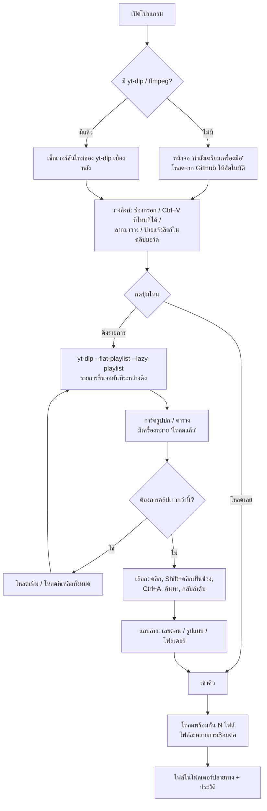
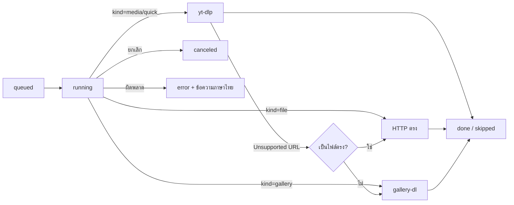
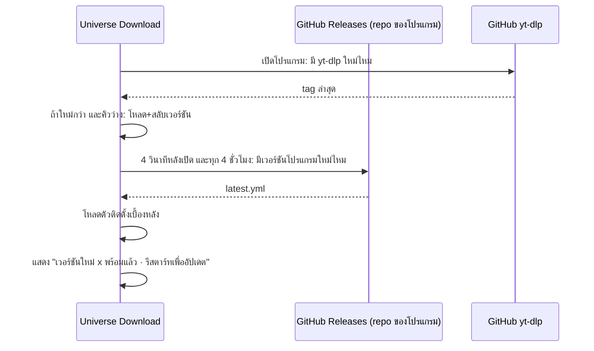

# Universe Download: Flow การทำงานของระบบ

## 1. ภาพรวม

โปรแกรมดาวน์โหลดสำหรับ Windows ที่รับลิงก์ได้แทบทุกแบบ ทั้งคลิปเดียว เพลย์ลิสต์ ทั้งช่อง/บัญชี อัลบั้มรูป และลิงก์ไฟล์ตรง ต่อยอดจาก TikTok Downloader ตัวเดิม แต่เปลี่ยนจาก PowerShell + Windows Forms มาใช้ Electron (หน้าจอแบบเว็บ) และอัปเดตตัวเองได้

| ส่วนประกอบ | หน้าที่ |
|---|---|
| `src/main/main.js` | เปิดหน้าต่าง รับคำสั่งจากหน้าจอ (IPC) |
| `src/main/tools.js` | ติดตั้ง/อัปเดต yt-dlp, ffmpeg, gallery-dl อัตโนมัติจาก GitHub |
| `src/main/fetcher.js` | ดึงรายการแบบสตรีม แยกประเภทลิงก์ (สื่อ / ไฟล์ตรง / แกลเลอรี) |
| `src/main/queue.js` | คิวดาวน์โหลดที่โหลดพร้อมกันได้หลายไฟล์ |
| `src/main/thumbs.js` | โหลดรูปปกผ่าน `udthumb://` พร้อมแคชลงดิสก์ |
| `src/main/updater.js` | อัปเดตตัวโปรแกรมจาก GitHub Releases |
| `src/main/store.js` | การตั้งค่า ประวัติ และรายการที่โหลดแล้ว |
| `src/renderer/*` | หน้าจอ (HTML/CSS/JS) |

ตัวช่วยเบื้องหลัง (โปรแกรมโหลดให้เองตอนเปิดครั้งแรก ผู้ใช้ไม่ต้องวางไฟล์เอง)

| เครื่องมือ | ใช้ทำอะไร | ที่มา |
|---|---|---|
| yt-dlp (แบบโฟลเดอร์ `yt-dlp_win.zip`) | วิดีโอ/เสียง จากกว่า 1,800 เว็บ | `yt-dlp/yt-dlp` |
| ffmpeg | รวมภาพ+เสียง แปลงไฟล์ ฝังปก/ข้อมูล | `yt-dlp/FFmpeg-Builds` |
| gallery-dl | รูปภาพ/อัลบั้ม (โหลดเมื่อจำเป็นครั้งแรก) | `mikf/gallery-dl` หรือ `gdl-org/builds` |
| Node (มากับ Electron) | ตัวรัน JavaScript ที่ YouTube ต้องใช้ | ติดมากับโปรแกรม |

ทั้งหมดเก็บที่ `%APPDATA%\Universe Download\bin`

---

## 2. Flow หลัก



---

## 3. ทำไมเร็วกว่าตัวเดิม

| ตัวเดิม (TikTok Downloader) | ตัวใหม่ | ผล |
|---|---|---|
| รอให้ yt-dlp ดึงรายการเสร็จก่อน แล้วค่อยแสดงทีเดียว | อ่านผลลัพธ์ทีละบรรทัด ส่งขึ้นจอทุก 0.12 วินาที | เห็นรายการแรกภายใน ~1.5 วินาที (YouTube) |
| `yt-dlp.exe` ไฟล์เดียว ต้องแตกไฟล์ตัวเองทุกครั้งที่รัน | ใช้ `yt-dlp_win.zip` แบบโฟลเดอร์ | เปิด yt-dlp แต่ละครั้งเร็วขึ้นมาก (~0.7 วินาที) |
| โหลดทีละคลิป และพัก 3 วินาทีทุกคลิป | โหลดพร้อมกัน 3 ไฟล์ (ตั้งได้ 1–10) ไม่พักเป็นค่าเริ่มต้น | TikTok 4 คลิป (~50 MB) เสร็จใน 12.5 วินาที |
| ไฟล์ละ 1 การเชื่อมต่อ | `-N 4` แบ่งไฟล์โหลดพร้อมกัน | YouTube ได้ความเร็วสูงสุด ~44 MB/s ในการทดสอบ |
| Timer อ่านไฟล์ log ทั้งไฟล์ทุก 0.6 วินาที แล้วสแกนทุกบรรทัดใหม่ | อ่านสตรีม stdout ตรงๆ ใช้ `--progress-template` แบบ JSON | ไม่หน่วงขึ้นตามความยาว log |
| ตัดขอบดำรูปปกด้วย `GetPixel` ใน PowerShell บนเธรดหน้าจอ | ให้ Chromium แสดงรูปเอง (`object-fit: cover`) | เลื่อนดูลื่น ไม่ค้าง |
| ปกเก็บในหน่วยความจำ เปิดใหม่ต้องโหลดใหม่ | แคชลงดิสก์ (`thumbcache`) | เปิดบัญชีเดิมซ้ำ ปกขึ้นทันที |

---

## 4. รายละเอียดแต่ละขั้นตอน

### 4.1 ดึงรายการ (`fetcher.js`)
```
yt-dlp <url> --flat-playlist --lazy-playlist --ignore-errors --encoding utf-8
       --playlist-items start:end
       -O "%(.{id,title,url,webpage_url,duration,uploader,thumbnails,...})j"
       --js-runtimes node:<Electron>
```
- ผลลัพธ์เป็น JSON บรรทัดละรายการ แยกได้ตรงๆ ไม่ต้องใช้ตัวคั่น `<SEP>` แบบเดิม
- เลือกรูปปกขนาดที่พอดีกับการ์ด (กว้าง ≥360px ที่เล็กที่สุด) แทนภาพเต็ม
- รายการซ้ำ (extractor + id ตรงกัน) จะถูกข้าม
- รายการที่เป็นเพลย์ลิสต์ย่อย/แท็บของช่อง แสดงป้าย "เพลย์ลิสต์" กด "เปิดดูข้างใน" ได้
- **ถ้า yt-dlp ไม่รู้จักลิงก์**
  1. ตรวจ header ของลิงก์ ถ้าไม่ใช่หน้าเว็บ ให้ถือว่าเป็น "ไฟล์ตรง" (pdf, zip, exe, รูป ฯลฯ)
  2. ถ้าเป็นหน้าเว็บ ให้ส่งต่อโหมด "รูปภาพ/แกลเลอรี" (gallery-dl)
- yt-dlp ตอบว่าเป็นลิงก์ Generic แต่ไฟล์ไม่ใช่วิดีโอ/เสียง ก็จะเปลี่ยนไปใช้ตัวโหลดไฟล์ตรงเช่นกัน

### 4.2 คิวดาวน์โหลด (`queue.js`)

- อาร์กิวเมนต์หลักของ yt-dlp
  ```
  -o "<โฟลเดอร์>\[ชื่อช่อง\][เลขตอน - ]<ชื่อไฟล์>"
  --progress-template "download:UDP%(progress)j"
  --print-to-file after_move:%(filepath)s <tmp>
  -N 4 --retries 10 --fragment-retries 10
  --download-archive "%APPDATA%\Universe Download\downloaded.txt"
  --embed-metadata --embed-chapters --embed-thumbnail
  ```
- ความคืบหน้า ความเร็ว และเวลาที่เหลือ อ่านจาก JSON ของ `--progress-template` โดยตรง
- `downloaded.txt` ใช้รวมทุกโฟลเดอร์: กันโหลดซ้ำ และทำเครื่องหมาย "✓ โหลดแล้ว" บนการ์ด (ปุ่ม "โหลดซ้ำ" ข้ามการเช็กนี้ได้)
- **เลขตอน:** เปิด "ใส่เลขตอน เริ่มที่ N" แล้วไฟล์จะได้ `01 - …`, `02 - …` และการ์ดที่เลือกจะมีป้าย "ตอน xx" ให้เห็นก่อนโหลด กดรอบต่อไปเลขจะต่อจากเดิมอัตโนมัติ
  - **เก่า → ใหม่** (ค่าเริ่มต้น): เรียงตามวันที่ลงคลิป ถ้าไม่มีวันที่ หน้าช่อง/บัญชี (ใหม่สุดอยู่บน) จะนับจากล่างขึ้นบน ส่วนเพลย์ลิสต์/อัลบั้มนับจากบนลงล่าง
  - **ตามลำดับบนจอ**: นับจากบนลงล่างตามที่เห็น (ใช้คู่กับปุ่ม "กลับลำดับ" ได้)
- ข้อความผิดพลาดแปลเป็นภาษาไทยพร้อมวิธีแก้ เช่น ต้องล็อกอิน, 429 จำกัดความถี่, 403, ความละเอียดไม่มี, ไม่เปิดในประเทศ

### 4.3 รูปแบบไฟล์
| ตัวเลือก | อาร์กิวเมนต์ |
|---|---|
| วิดีโอ · คมชัดที่สุด | `-f "bv*+ba/b" -S "res,fps,vcodec:h264,acodec:aac" --merge-output-format mp4` |
| 4K / 1440p / 1080p / 720p / 480p / 360p | `-f "bv*[height<=H]+ba/b[height<=H]/b" -S "res:H,..."` |
| เสียง · MP3 | `-f ba/b -x --audio-format mp3 --audio-quality 0` |
| เสียง · M4A | `-f "ba[ext=m4a]/ba/b" -x --audio-format m4a` |
| ไฟล์ต้นฉบับ | `-f "bv*+ba/b"` (ไม่แปลง) |

ชอบ H.264/AAC ก่อนเมื่อความละเอียดเท่ากัน เพื่อให้เปิดได้ทุกเครื่อง

### 4.4 รูปปก (`thumbs.js`)
- หน้าจอขอรูปผ่าน `udthumb://t/?u=<url>` ฝั่งโปรแกรมโหลดให้พร้อมใส่ Referer ที่เว็บต้องการ (เช่น TikTok)
- เก็บแคชใน `%APPDATA%\Universe Download\thumbcache` (เกิน 400 MB ลบไฟล์เก่าอัตโนมัติ)
- ปก HEIC (Chromium เปิดไม่ได้) แปลงเป็น JPG ด้วย ffmpeg
- โหลดเฉพาะปกที่เห็นบนจอ (`loading="lazy"`) และการ์ดนอกจอไม่ถูกวาด (`content-visibility: auto`)

---

## 5. การอัปเดต



**ออกเวอร์ชันใหม่ (สำหรับผู้พัฒนา)** — repo: `Anuphat-C/UniverseDowload`
1. เปลี่ยน `version` ใน `package.json` (เช่น 1.0.0 → 1.0.1) แล้ว commit + push
2. สร้าง tag ให้ตรงกับเวอร์ชัน แล้ว push tag
   ```powershell
   git tag v1.0.1
   git push origin v1.0.1
   ```
3. GitHub Actions (`.github/workflows/release.yml`) จะ build บน Windows แล้วอัปโหลด `UniverseDownload-Setup-x.y.z.exe` + `latest.yml` ขึ้น Releases ให้เอง (ไม่ต้องใช้ token ในเครื่อง)
4. โปรแกรมของผู้ใช้ทุกเครื่องจะเห็นเวอร์ชันใหม่เองภายใน 4 ชั่วโมง หรือตอนเปิดโปรแกรมครั้งถัดไป

ถ้าจะออกจากเครื่องตัวเองแทน: ตั้ง `GH_TOKEN` แล้วรัน `npm run release`

---

## 6. ไฟล์ที่ระบบสร้าง

| ไฟล์ | ที่อยู่ | ใช้ทำอะไร |
|---|---|---|
| `settings.json` | `%APPDATA%\Universe Download` | การตั้งค่าทั้งหมด (จำค่าล่าสุด) |
| `history.json` | `%APPDATA%\Universe Download` | ประวัติ 1,000 รายการล่าสุด |
| `downloaded.txt` | `%APPDATA%\Universe Download` | รายการที่โหลดแล้ว (archive ของ yt-dlp) |
| `bin\` | `%APPDATA%\Universe Download` | yt-dlp / ffmpeg / gallery-dl |
| `thumbcache\` | `%APPDATA%\Universe Download` | แคชรูปปก |
| ไฟล์ที่โหลด | `Downloads\Universe Download` (เปลี่ยนได้) | วิดีโอ เสียง รูป ไฟล์ |

---

## 7. การพัฒนา

```powershell
npm install
npm start          # รันโหมดพัฒนา
npm run dist       # สร้างตัวติดตั้ง dist\UniverseDownload-Setup-x.y.z.exe
npm run release    # สร้าง + อัปโหลดขึ้น GitHub Releases (ต้องมี GH_TOKEN)
```

---

## 8. ข้อจำกัดที่รู้อยู่แล้ว
- **เว็บที่ต้องล็อกอิน** (Instagram, Facebook บางโพสต์, คลิปส่วนตัว) ต้องเปิด "ใช้คุกกี้จากเบราว์เซอร์" Chrome/Edge รุ่นใหม่เข้ารหัสคุกกี้ไว้ อ่านได้ยาก แนะนำ Firefox
- **จำนวนคลิปทั้งหมดของบัญชี** เว็บส่วนใหญ่ไม่บอกตัวเลขนี้ จะรู้ก็ต่อเมื่อดึงจนครบ
- **TikTok/Instagram** ถ้าโหลดพร้อมกันเยอะเกินไปอาจโดนจำกัดความถี่ (429) ให้ลด "โหลดพร้อมกัน" หรือเพิ่ม "พักระหว่างไฟล์"
- **ตัวติดตั้งยังไม่ได้เซ็นดิจิทัล** Windows SmartScreen จะเตือนตอนติดตั้งครั้งแรก (กด "ข้อมูลเพิ่มเติม" → "เรียกใช้ต่อไป")
- **ลิขสิทธิ์** เนื้อหาเป็นของเจ้าของ ควรใช้ส่วนตัว หรือขออนุญาตก่อนนำไปเผยแพร่
